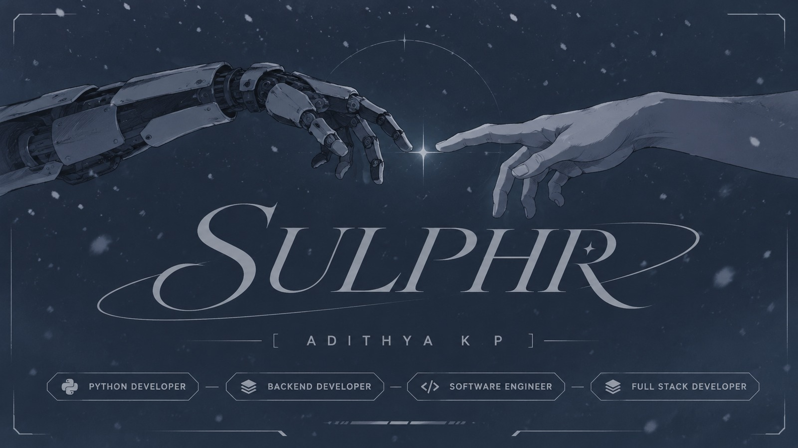
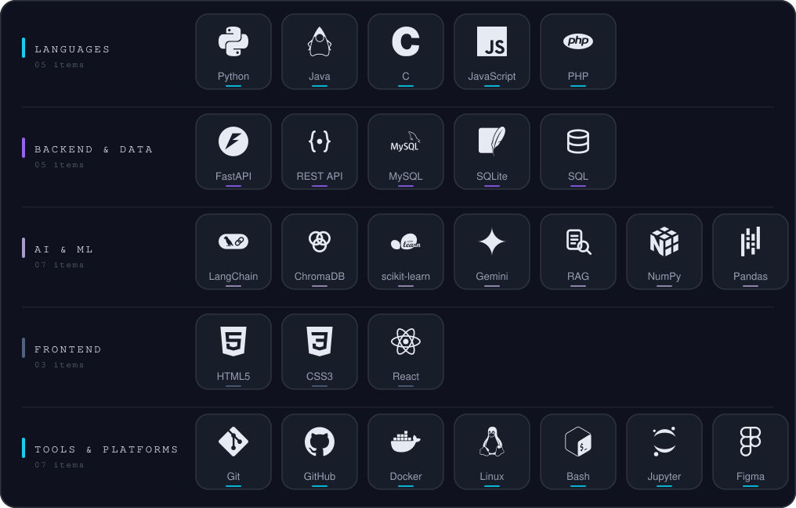
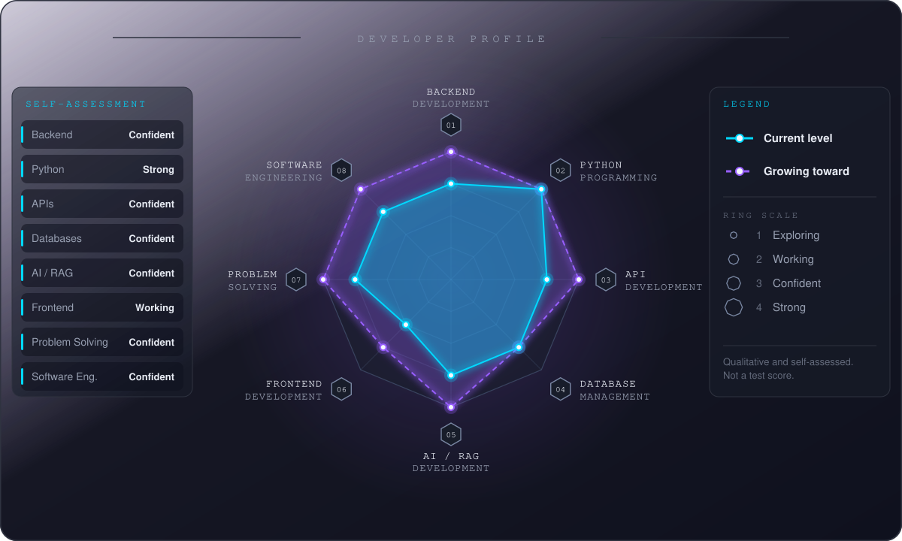
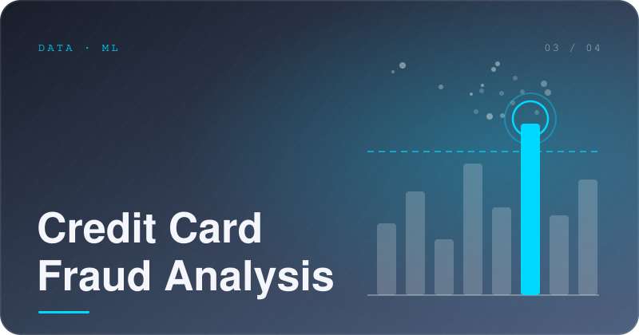
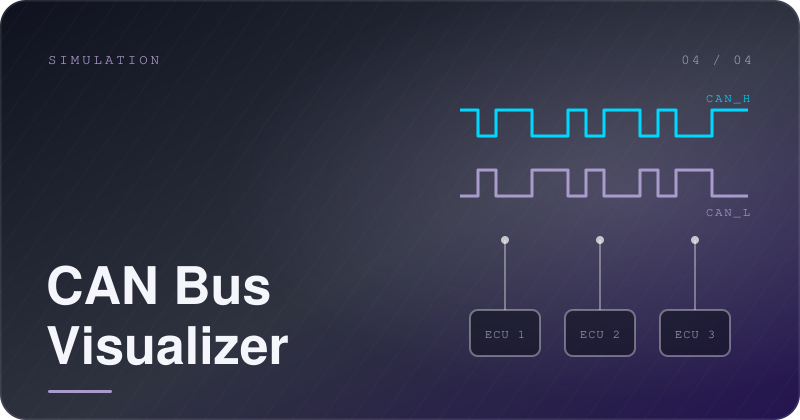

 

<code>ABOUT</code>

I'm a Computer Science graduate who likes backend engineering, AI-driven applications and the unglamorous parts of software that make things dependable.
 
I learn by building: pick an idea, break it, rebuild it better, and keep what it teaches me.

 

<code>TECH STACK</code>

 

<code>SKILL RADAR</code>

 

<code>FEATURED PROJECTS</code>

<table>
  <tr>
    <td width="50%" valign="top">
      
      <h4><a href="https://github.com/sulphurr/collegebot">AI Campus Navigation</a></h4>
      A chatbot that answers plain-English questions about room locations, faculty schedules and staffroom details, backed by a RAG pipeline.
        
      <code>Python</code> · <code>FastAPI</code> · <code>LangChain</code> · <code>ChromaDB</code> · <code>Gemini</code> · <code>MySQL</code>
    </td>
    <td width="50%" valign="top">
      
      <h4><a href="https://github.com/sulphurr/Secure-Vault">Secure File Vault</a></h4>
      A desktop vault layering AES-256 encryption, image steganography, keystroke-dynamics login, a decoy vault, a blockchain integrity ledger and IPFS backup. Published as a <a href="https://sulphurr.github.io/secure-vault-paper.pdf">journal paper</a>.
        
      <code>Python</code> · <code>Tkinter</code> · <code>PyQt</code> · <code>scikit-learn</code> · <code>IPFS</code>
    </td>
  </tr>
  <tr>
    <td width="50%" valign="top">
      
      <h4><a href="https://github.com/sulphurr/Credit-Card-Fraud-Risk-Analysis-and-Fraud-Prediction">Credit Card Fraud Analysis</a></h4>
      Risk analysis and fraud prediction on credit card transactions, documented as a notebook.
        
      <code>Python</code> · <code>Jupyter Notebook</code>
    </td>
    <td width="50%" valign="top">
      
      <h4><a href="https://github.com/sulphurr/can_bus_visualizer">CAN Bus Visualizer</a></h4>
      A simulated CAN bus with a live visualizer for watching message traffic between nodes.
        
      <code>Python</code> · <code>Tkinter</code> · <code>Matplotlib</code>
    </td>
  </tr>
</table>

Also on GitHub: <a href="https://github.com/sulphurr/password_strength_analyzer">password_strength_analyzer</a> · <a href="https://github.com/sulphurr?tab=repositories">all repositories</a>

 

<code>ACTIVITY</code>

 

<code>CONTACT</code>

